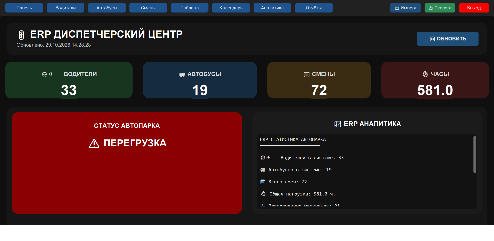

# АСУ планирования графиков водителей (Учебный проект)

Демонстрационный прототип системы автоматизации для автотранспортного парка. Разработан в рамках производственной практики.

**Внимание:** Проект использует исключительно тестовые данные. Все реальные учетные записи и персональные данные удалены или заменены заглушками в целях конфиденциальности.

### Функционал:
* Интеграция с 1С (обмен данными через JSON).
* Автоматическая выгрузка отчетов в Excel.
* Работа с базой данных SQLite.

### Стек технологий:
Python, Tkinter, SQLite, JSON, 1С.

### Как запустить локально:
1. Установите зависимости: `pip install -r requirements.txt`
2. Запустите главный файл: `python main.py`

